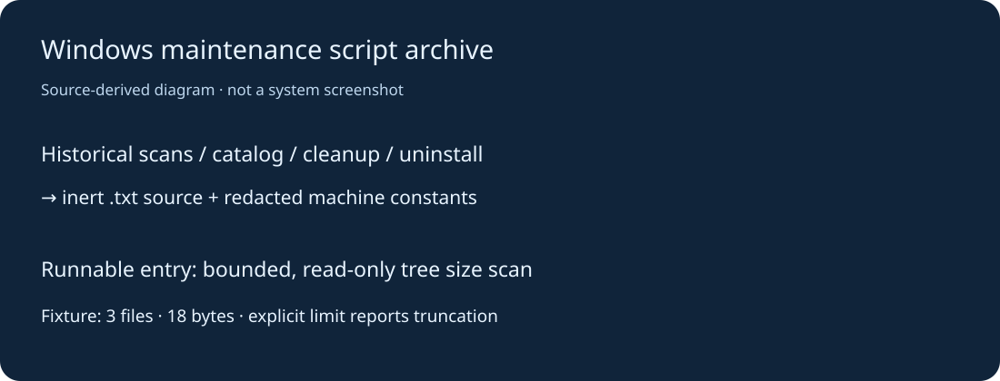

# Windows 维护脚本档案

把多轮目录体积检查、缓存研究、软件清单与历史整理脚本集中保存。保留原始版本差异，个人机器路径、加密卸载参数与本机SID改为占位；历史代码以 `.py.txt` / `.ps1.txt` 保存，双击或导入不会直接触发清理。软件知识库是历史文案，不作为当前软件推荐。



## 快速上手

需要 Python3.12或更新版本。只读入口仅用标准库，适用于目录体积盘点：

```sh
python scripts/scan_tree.py /path/to/your/folder --max-files 200000
python scripts/inspect_archive.py
```

Windows可将路径改成 `"D:\Projects"`。扫描只输出总字节、文件数、跳过数和是否截断，不删除文件，不联网。目录不存在会明确报错；符号链接与目录联接不递归跟随。

## 目录与完整性

- `archive/`：按用途保留全部选定历史程序，函数、控制流和版本均保留；机器常量经过替换。这些历史脚本没有统一命令行，不能直接运行，需先逐行适配和审查。清理、卸载、快捷方式创建与目录移动逻辑仍属于代码档案，未执行验收。
- `scripts/`：可直接使用的只读大小扫描、历史Python语法检查。
- `docs/archive-index.json`：每个归档源的类型、范围和处理状态。

原始本机扫描结果、软件安装清单、会话内容、财产信息和机器配置不在公开包中。档案里的历史授权措辞不构成本次运行授权。

## 验证与计划

2026-10-26：真实构造3文件18字节隔离目录，完整扫描得到3/18，限制2文件得到2/8并明确截断；历史Python全部语法解析通过，原脚本未执行。仅验证Windows/Python3.12，不代表系统清理或卸载效果通过。下一步可逐个把历史工具改为参数化、默认只读程序；目前按代码档案维护。原机器数据与报告未归档，不能据此删除整个原会话目录。

原创脚本采用MIT许可；不分发第三方软件、系统组件或卸载工具。
